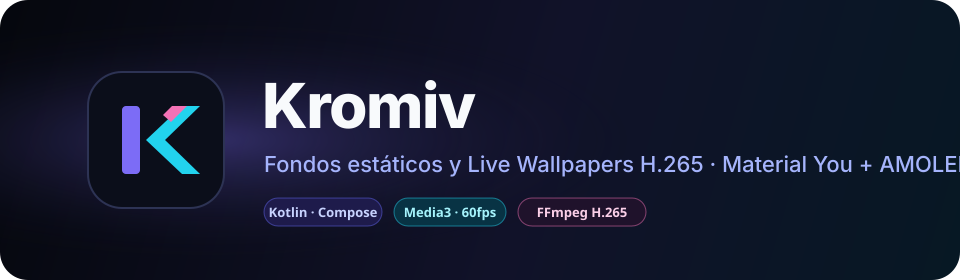

<p align="center">
  
</p>

<p align="center">
  <a href="https://github.com/karmaoriginal/stunning-octo-couscous/actions/workflows/build.yml">
    
  </a>
  
  
  <a href="LICENSE">
    
  </a>
</p>

# Kromiv

**Kromiv** (`app.kromiv`) es una aplicación Android moderna, ligera y de alto rendimiento para gestionar, mejorar y aplicar **fondos de pantalla estáticos y animados (Live Wallpapers)** desarrollada en **Kotlin + Jetpack Compose (Material 3)** con tema dinámico **Material You** y modo **Negro Puro AMOLED**.

> **Nota de repositorio:** Por restricciones del entorno de sesión, el código reside en `karmaoriginal/stunning-octo-couscous` bajo el nombre de aplicación, módulo raíz e identificador `kromiv` / `app.kromiv`.

---

## Funciones principales

- **Importación privada sin permisos amplios**:
  - Usa **Android Photo Picker** y **Storage Access Framework (SAF)** (`OpenMultipleDocuments`) sin solicitar `READ_EXTERNAL_STORAGE` ni `READ_MEDIA_*`.
  - Formatos de imagen soportados: `JPG`, `PNG`, `WEBP`, `HEIC`, `AVIF`, `GIF` (animado) y `BMP`.
  - Formatos de video soportados: `MP4`, `MKV`, `WEBM`, `MOV` y `3GP`.
- **Aplicación directa estática y animada**:
  - **Estáticos**: `WallpaperManager` con recorte interactivo (pinch-to-zoom y pan), selección de pantalla de **Inicio**, **Bloqueo** o **Ambos**.
  - **Videos y GIF/WebP animados**: `KromivLiveWallpaperService` basado en **Media3 ExoPlayer** (decodificación por hardware `MediaCodec`), bucle sin cortes, silenciado configurable y límite de FPS (30/60).
- **Mejora inteligente de video en segundo plano (WorkManager + FFmpeg)**:
  - Detecta videos de baja resolución (`< 1080p`) o bajo bitrate y ofrece **"Mejorar"** una sola vez en segundo plano (nunca en tiempo real).
  - Pipeline FFmpeg: escalado `lanczos` a **1080p** o **1440p**, reducción de ruido `hqdn3d`, nitidez `unsharp` y recodificación eficiente a **H.265 (HEVC)** (`hevc_mediacodec` por hardware con fallback LGPL `libkvazaar`).
  - Notificación con progreso en tiempo real y cancelación inmediata.
  - Interfaz desacoplada `AiUpscaler` (`NoOpAiUpscaler` por defecto, desactivada en Ajustes) lista para conectar un modelo ligero TFLite/NCNN sin inflar el APK.
- **Tienda integrada con catálogo CC0**:
  - Catálogo remoto versionado en `docs/catalog.json` (GitHub Pages + fallback automático a GitHub Raw y copia offline en `assets/catalog_fallback.json`).
  - 9 categorías: **Oscuro / AMOLED**, **Abstracto**, **Espacio**, **Naturaleza**, **Agua**, **Colores**, **Minimalista**, **Paisajes** y **Anime**.
  - Buscador en tiempo real, filtros por foto/video, ordenación (*Populares*, *Recientes*, *Favoritos*), miniaturas WebP ligeras, preview de video corto y **descarga reanudable** HTTP `Range` con verificación SHA-256 y modo *Solo Wi-Fi*.
- **Biblioteca local y control de almacenamiento**:
  - Deduplicación por SHA-256 al importar, renombrado, eliminación limpia, desglose real de espacio usado y limpieza de caché/descargas parciales.
- **UI/UX 60/120 fps**:
  - Material You dinámico + AMOLED `#000000`, transiciones compartidas (`SharedTransitionLayout`), shimmer skeletons, spring bounce, parallax en vista previa y modo **"Probar antes de aplicar"** con mockup de Pantalla de Bloqueo e Inicio.

---

## Capturas de pantalla (Placeholders)

| Explorar (Masonry + Tienda) | Vista previa + Mockup | Biblioteca & Importación | Mejora FFmpeg H.265 |
| :---: | :---: | :---: | :---: |
|  |  |  |  |

---

## Arquitectura y Stack

Arquitectura **MVVM multi-módulo** limpia sin librerías de inyección pesadas:

```text
kromiv/
├── core/
│   ├── model/   # Modelos puros Kotlin, enums, CatalogManifest, EnhanceAdvisor
│   ├── data/    # Room (Wallpapers + Favorites), DataStore, OkHttp Range Downloader, MediaInspector
│   └── media/   # Coil 3 (AVIF/HEIC/GIF), ExoPlayer WallpaperService, StaticWallpaperApplier, FFmpeg Worker & AiUpscaler
├── app/         # Compose Material 3 UI, SharedTransitionLayout, ViewModel, Baseline Profile, R8
├── docs/        # GitHub Pages (index.html, catalog.json, thumbs/*.webp, banner.svg)
└── scripts/     # Generador de arte procedural CC0 1.0 y manifest
```

| Capa | Tecnología |
| --- | --- |
| Lenguaje & UI | Kotlin 2.1, Jetpack Compose (Material 3 BOM 2025.05.01), `SharedTransitionLayout` |
| Video & Live Wallpaper | AndroidX Media3 ExoPlayer 1.6.1, `WallpaperService` |
| Imágenes | Coil 3.2.0 (`coil-compose`, `coil-gif`, `coil-network-okhttp`), `avif-coder-coil` 2.1.4 (AVIF/HEIC) |
| Procesamiento de video | `dev.ffmpegkit-maintained:ffmpeg-kit-video:8.1.9` (LGPL-3.0, SDK 35, alineación 16 KB) |
| Persistencia & Red | Room 2.7.1 (KSP), DataStore Preferences 1.1.4, WorkManager 2.10.0, OkHttp 4.12.0, Kotlinx Serialization |
| Rendimiento | Baseline Profiles (`baseline-prof.txt` + `profileinstaller`), R8 + `shrinkResources`, ABI splits |

---

## Cómo descargar el APK

1. **Desde GitHub Releases (recomendado)**:
   - Ve a la pestaña **[Releases](https://github.com/karmaoriginal/stunning-octo-couscous/releases)** y descarga el archivo `kromiv-v*-arm64-v8a-release.apk` (para la mayoría de teléfonos Android modernos) o `x86_64` para emuladores.
2. **Desde GitHub Actions (último build)**:
   - Entra en **[Actions → Build Kromiv Android APK](https://github.com/karmaoriginal/stunning-octo-couscous/actions/workflows/build.yml)**, abre la ejecución más reciente en verde y descarga el artifact **`kromiv-release-apk`**.

---

## Cómo compilar

Requisitos: **JDK 17** y **Android SDK 35**.

```bash
# Clonar repositorio
git clone https://github.com/karmaoriginal/stunning-octo-couscous.git
cd stunning-octo-couscous

# Ejecutar tests unitarios y compilar APKs release (arm64-v8a y x86_64)
./gradlew test assembleRelease --stacktrace
```

Opcionalmente, para firmar con tu propio keystore exporta antes de compilar:
```bash
export KROMIV_KEYSTORE_PATH=/ruta/a/tu-keystore.jks
export KROMIV_KEYSTORE_PASSWORD=...
export KROMIV_KEY_ALIAS=...
export KROMIV_KEY_PASSWORD=...
```
Si no se definen, Gradle usará firma de depuración local (y en GitHub Actions se genera un keystore de release temporal o se usan los secrets `KEYSTORE_BASE64`, `KEYSTORE_PASSWORD`, `KEY_ALIAS`, `KEY_PASSWORD`).

---

## Cómo añadir contenido nuevo a la tienda (`catalog.json`)

El catálogo es declarativo y se sirve desde `docs/catalog.json` mediante GitHub Pages, mientras los archivos multimedia completos se suben a **GitHub Releases**:

1. **Prepara los archivos (solo contenido CC0 / libre de regalías)**:
   - Miniatura ligera en WebP (`360×800`, `< 40 KB`) en `docs/thumbs/<id>.webp`.
   - Archivo completo en WebP/PNG/AVIF/MP4 y, si es video, un clip corto de vista previa (`<id>-preview.mp4`).
2. **Sube los archivos pesados** a un Release de GitHub (por ejemplo `catalog-v1` o `catalog-v2`).
3. **Calcula tamaño y SHA-256**:
   ```bash
   stat -c%s archivo.mp4
   sha256sum archivo.mp4
   ```
4. **Agrega la entrada en `docs/catalog.json`** (y copia a `app/src/main/assets/catalog_fallback.json` si quieres incluirla offline):
   ```json
   {
     "id": "space-nova-02",
     "title": "Nova Drift",
     "author": "Tu Nombre",
     "license": "CC0 1.0",
     "category": "space",
     "mediaType": "video",
     "format": "mp4",
     "thumbnailUrl": "https://karmaoriginal.github.io/stunning-octo-couscous/thumbs/space-nova-02.webp",
     "previewUrl": "https://github.com/karmaoriginal/stunning-octo-couscous/releases/download/catalog-v1/space-nova-02-preview.mp4",
     "downloadUrl": "https://github.com/karmaoriginal/stunning-octo-couscous/releases/download/catalog-v1/space-nova-02.mp4",
     "width": 1080,
     "height": 1920,
     "durationMs": 4000,
     "bitrateBps": 2400000,
     "fps": 30.0,
     "fileSizeBytes": 1200450,
     "sha256": "...",
     "popularity": 90,
     "createdAtEpochMs": 1763700000000,
     "tags": ["espacio", "nebulosa", "live"]
   }
   ```
   Categorías válidas: `amoled`, `abstract`, `space`, `nature`, `water`, `colors`, `minimal`, `landscapes`, `anime`.
5. Haz commit y push a `main` para que `.github/workflows/pages.yml` actualice GitHub Pages automáticamente.

También puedes regenerar el paquete inicial de ejemplo ejecutando `scripts/generate_cc0_catalog.py`.

---

## Optimizaciones implementadas

- **APK mínimo**: R8 (`isMinifyEnabled = true`), `isShrinkResources = true`, splits por ABI (`arm64-v8a` principal y `x86_64`), iconos vectoriales propios sin `material-icons-extended`, solo variante LGPL `ffmpeg-kit-video` con soporte de páginas de 16 KB.
- **Batería**: `KromivLiveWallpaperService` detiene inmediatamente ExoPlayer o el loop animado cuando `onVisibilityChanged(false)`, `ACTION_SCREEN_OFF` o `ACTION_POWER_SAVE_MODE_CHANGED`; límite configurable de 30/60 fps (`Surface.setFrameRate` + selector de pistas).
- **Rendimiento**: `Baseline Profile` (`src/main/baseline-prof.txt`) + `profileinstaller`, `key` estables en `LazyVerticalStaggeredGrid`, caché de memoria acotada al 15% y liberación estricta de `ExoPlayer` en `DisposableEffect` / `onSurfaceDestroyed`.
- **Almacenamiento**: Deduplicación SHA-256 al importar, descargas `.part` atómicas reanudables por `Range`, límite configurable de caché de disco en Coil (128 MB–1 GB) y botón de limpieza directa.

---

## Roadmap

- [ ] Integración opcional de modelo ligero ESRGAN-x2-lite / FSRCNN (TFLite GPU Delegate) sobre la interfaz `AiUpscaler`.
- [ ] Cambio automático de wallpaper programado por horario o modo oscuro/claro del sistema.
- [ ] Colecciones comunitarias y envío de packs CC0 mediante Pull Requests validados en CI.
- [ ] Generación automatizada de Baseline Profile con módulo Macrobenchmark en dispositivo físico.

---

## Créditos y Licencias de Contenido

- Todo el contenido inicial incluido en `docs/catalog.json` y `docs/thumbs/` consiste en **arte generativo original creado específicamente para Kromiv** mediante `scripts/generate_cc0_catalog.py` y se publica bajo **CC0 1.0 Universal (Dominio Público)**.
- Código fuente de **Kromiv** bajo **Licencia MIT** ([LICENSE](LICENSE)).
- Librerías de terceros: `FFmpegKit` community fork (`dev.ffmpegkit-maintained:ffmpeg-kit-video`, LGPL-3.0), AndroidX Media3 / Compose / Room / WorkManager (Apache 2.0), Coil 3 (Apache 2.0), `avif-coder-coil` (Apache 2.0 / BSD-3-Clause), OkHttp (Apache 2.0).
